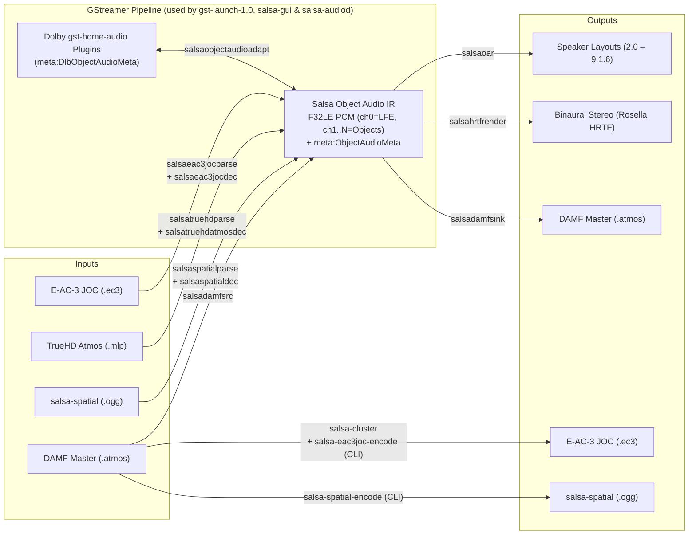

# Salsa

**SALSA** — *SALSA Ain't Licensed Spatial Audio*

Salsa is an open-source spatial audio toolkit and GStreamer plugin suite for **Dolby Atmos** and **salsa-spatial** object audio. It supports **E-AC-3 JOC** and **salsa-spatial** encoding and decoding, **TrueHD Atmos** decoding, **DAMF** (Dolby Atmos Master Format) reading/writing and object clustering, multi-speaker (`2.0`–`9.1.6`) and binaural (**Rosella HRTF**) rendering, and interoperability with **Dolby `gst-home-audio` plugins**.

> [!TIP]
> Salsa is designed specifically for spatial object audio. For standard (non-object) TrueHD or E-AC-3 streams, use standard GStreamer decoders.

---

## Table of Contents

- [Salsa](#salsa)
  - [Table of Contents](#table-of-contents)
  - [Overview \& Components](#overview--components)
  - [Prerequisites \& Building](#prerequisites--building)
    - [System Dependencies](#system-dependencies)
    - [Workspace Build](#workspace-build)
  - [1. Salsa Studio (GUI Preview Player)](#1-salsa-studio-gui-preview-player)
    - [Features](#features)
    - [Run the GUI](#run-the-gui)
    - [Build a macOS App Bundle](#build-a-macos-app-bundle)
  - [2. Virtual Audio Device for `mpv` (macOS \& Linux)](#2-virtual-audio-device-for-mpv-macos--linux)
    - [macOS Setup (CoreAudio HAL + LaunchAgents)](#macos-setup-coreaudio-hal--launchagents)
      - [1. Build the daemon and HAL drivers](#1-build-the-daemon-and-hal-drivers)
      - [2. Install the virtual audio devices and LaunchAgents](#2-install-the-virtual-audio-devices-and-launchagents)
      - [3. Configure output and rendering mode](#3-configure-output-and-rendering-mode)
      - [4. Start the services](#4-start-the-services)
      - [5. Play with `mpv`](#5-play-with-mpv)
      - [6. Update settings, stop, or uninstall](#6-update-settings-stop-or-uninstall)
    - [Linux Setup (ALSA Plugin + Daemon)](#linux-setup-alsa-plugin--daemon)
      - [1. Build the daemon and ALSA plugin](#1-build-the-daemon-and-alsa-plugin)
      - [2. Install the ALSA plugin and Salsa service](#2-install-the-alsa-plugin-and-salsa-service)
      - [3. Configure output and rendering mode](#3-configure-output-and-rendering-mode-1)
      - [4. Play with `mpv`](#4-play-with-mpv)
      - [5. Update settings, stop, or uninstall](#5-update-settings-stop-or-uninstall)
  - [3. CLI Tools: DAMF Clustering \& Encoding](#3-cli-tools-damf-clustering--encoding)
    - [Step 1: DAMF Object Clustering (`salsa-cluster`)](#step-1-damf-object-clustering-salsa-cluster)
      - [Clustering Options](#clustering-options)
    - [Step 2: DAMF → E-AC-3 JOC Encoder (`salsa-eac3joc-encode`)](#step-2-damf--e-ac-3-joc-encoder-salsa-eac3joc-encode)
      - [`reac3e` Core Parameters](#reac3e-core-parameters)
      - [JOC / OAMD / EMDF Parameters](#joc--oamd--emdf-parameters)
      - [Downmix \& Signing Parameters](#downmix--signing-parameters)
    - [DAMF → salsa-spatial Encoder (experimental)](#damf--salsa-spatial-encoder-salsa-spatial-encode-experimental)
      - [salsa-spatial Encoding Parameters](#salsa-spatial-encoding-parameters)
  - [4. GStreamer Plugins](#4-gstreamer-plugins)
    - [Elements Overview](#elements-overview)
    - [Quick Start Pipelines](#quick-start-pipelines)
      - [Build and Inspect Plugins](#build-and-inspect-plugins)
      - [Render to Speaker Layout (`salsaoar`)](#render-to-speaker-layout-salsaoar)
      - [Render to Binaural Stereo (`salsahrtfrender`)](#render-to-binaural-stereo-salsahrtfrender)
      - [Convert Bitstreams to DAMF Master (`salsadamfsink`)](#convert-bitstreams-to-damf-master-salsadamfsink)
    - [Internal Object Audio Format](#internal-object-audio-format)
    - [Element Reference](#element-reference)
      - [Parsers (`salsaeac3jocparse`, `salsatruehdparse`)](#parsers-salsaeac3jocparse-salsatruehdparse)
      - [Decoders (`salsaeac3jocdec`, `salsatruehdatmosdec`)](#decoders-salsaeac3jocdec-salsatruehdatmosdec)
      - [salsa-spatial Parser \& Decoder (experimental)](#salsa-spatial-parser--decoder-experimental)
      - [DAMF Source \& Sink (`salsadamfsrc`, `salsadamfsink`)](#damf-source--sink-salsadamfsrc-salsadamfsink)
        - [`salsadamfsrc` (DAMF Source)](#salsadamfsrc-damf-source)
        - [`salsadamfsink` (DAMF Sink)](#salsadamfsink-damf-sink)
      - [Speaker Renderer (`salsaoar`)](#speaker-renderer-salsaoar)
      - [Binaural HRTF Renderer (`salsahrtfrender`)](#binaural-hrtf-renderer-salsahrtfrender)
      - [Dolby Plugin Bridge (`salsaobjectaudioadapt`)](#dolby-plugin-bridge-salsaobjectaudioadapt)
  - [5. Testing \& Verification](#5-testing--verification)
    - [Unit Tests, Formatting \& Linting](#unit-tests-formatting--linting)
    - [Opt-in Real-Stream Integration Tests](#opt-in-real-stream-integration-tests)
  - [License](#license)
  - [References](#references)

---

## Overview & Components

Depending on your use case, you can interact with Salsa through several entry points:

| Component | Path | Purpose |
| :--- | :--- | :--- |
| **Salsa Studio (`salsa-gui`)** | `crates/apps/salsa-gui/` | Standalone GUI preview player with a real-time 3D object visualizer, speaker rendering (`2.0`–`9.1.6`), and binaural HRTF rendering for E-AC-3 JOC, TrueHD Atmos, salsa-spatial (`.ogg`), and DAMF files. |
| **Virtual Audio Daemon (`salsa-audiod`)** | `crates/apps/salsa-audiod/`, `platform/` | Experimental virtual IEC 61937 audio device (macOS HAL / Linux ALSA) that lets an unmodified `mpv` pass through E-AC-3 JOC and TrueHD Atmos for real-time rendering. |
| **DAMF Object Clusterer (`salsa-cluster`)** | `crates/apps/salsa-cluster/` | CLI tool that reduces complex DAMF masters down to at most $N$ dynamic objects (e.g., $\le 15$ for JOC encoding) while preserving the rendered spatial scene. |
| **E-AC-3 JOC Encoder (`salsa-eac3joc-encode`)** | `crates/apps/salsa-eac3joc-encode/` | CLI tool (and `eac3joc-encoder` library) that encodes a DAMF master (`.atmos` + `.atmos.audio` + `.atmos.metadata`) into an E-AC-3 JOC bitstream (`.ec3`). |
| **salsa-spatial Encoder (experimental)** | `crates/apps/salsa-spatial-encode/` | CLI tool (and `salsa-spatial-encoder` library) that encodes a DAMF master into one standard Ogg Opus multistream track with a 7.1 public layout and private reconstruction parameters. |
| **GStreamer Plugins** | `crates/gst-plugins/` | Eleven GStreamer elements across five plugins (`gst-eac3joc`, `gst-truehd`, `gst-salsa-spatial`, `gst-damf`, `gst-objectaudio`) for custom decoding, rendering, transcoding, and interoperating with Dolby `gst-home-audio` plugins. |



---

## Prerequisites & Building

### System Dependencies

- **Rust**: 1.91+ (Edition 2024)
- **GStreamer**: 1.24+ (`gstreamer-1.0`, `gstreamer-base-1.0`, `gstreamer-audio-1.0`)
- **FFmpeg**: `libavcodec` (`ffmpeg-next` 9.x)
- **Opus**: `libopus` for the salsa-spatial audio core

```sh
# macOS (Homebrew)
brew install pkg-config gstreamer ffmpeg opus

# Debian / Ubuntu
sudo apt-get install pkg-config libgstreamer1.0-dev libgstreamer-plugins-base1.0-dev \
  libasound2-dev libavcodec-dev libavformat-dev libavutil-dev libswresample-dev \
  libavfilter-dev libswscale-dev libopus-dev
```

### Workspace Build

```sh
# Build the entire workspace in release mode
cargo build --workspace --release

# Or build everything in debug mode
cargo build --workspace
```

---

## 1. Salsa Studio (GUI Preview Player)

`crates/apps/salsa-gui/` is a cross-platform `eframe`/`egui` preview player built on the Salsa GStreamer elements. Because it registers the Salsa GStreamer elements in-process, **no separate plugin build or `GST_PLUGIN_PATH` setup is required**.

### Features

- **Supported Formats**: Opens raw E-AC-3 JOC and TrueHD Atmos streams (`.ec3`, `.eac3`, `.mlp`, `.thd`, `.truehd`), salsa-spatial streams (`.ogg`), and DAMF masters (`.atmos`, `.damf`).
- **Rendering Modes**:
  - **Speaker virtualization**: Object-rendered `2.0`–`9.1.6` speaker layouts.
  - **Binaural virtualization**: Headphone rendering via a Rosella `.personalized_headphone` model.
- **3D Object Stage**: Real-time 3D scene displaying height-colored and level-sized audio objects, motion trails, speaker anchors, an LFE icon, and a binaural listener head icon.
  - Includes a Settings switch to show or hide static 3D labels (object IDs, speaker names, LFE, and listener); hovering an object always displays its details.
- **Playback & Transport**: Play/pause and keyboard shortcuts (`Space`, `←`/`→`, `Shift+←`/`→`, `Home`/`End`). E-AC-3 JOC, TrueHD Atmos, and DAMF support accurate seeking.
- **Quality-of-Life**: Device/layout fallback warning with a one-click switch to Binaural; recent files list; persisted output, model, volume, and window settings; built-in diagnostics.

### Run the GUI

```sh
cargo run --release -p salsa-gui -- /path/to/stream.ec3

# Open a salsa-spatial stream:
cargo run --release -p salsa-gui -- /path/to/stream.ogg
```

- **Opening files**: If launched without a path argument, use `Cmd+O`, the **Open** button, or drag and drop a file into the window. Playback starts paused.
- **Binaural playback**: Requires a Rosella `.personalized_headphone` model, which can be selected in the **Output** panel.
- **TrueHD duration scanning**: Raw TrueHD streams have no container duration; the app scans the parser output in the background and displays `Scanning…` until the full duration is known.

### Build a macOS App Bundle

```sh
SALSA_MODEL=/path/to/model.personalized_headphone \
  crates/apps/salsa-gui/scripts/bundle-macos.sh
```

This creates `target/release/Salsa Studio.app`, optionally bundles the Rosella headphone model, and ad-hoc signs the bundle. The Salsa elements are statically linked into the binary, though the app still uses the host's GStreamer and FFmpeg installations (it does not bundle a GStreamer runtime).

---

## 2. Virtual Audio Device for `mpv` (macOS & Linux)

*(Experimental)* This setup creates virtual IEC 61937 S/PDIF audio devices so that an **unmodified `mpv`** can bit-stream E-AC-3 JOC or TrueHD Atmos directly into Salsa for real-time speaker or binaural rendering.

### macOS Setup (CoreAudio HAL + LaunchAgents)

**Requirements**: macOS 12+, Xcode Command Line Tools, Rust 1.91+, GStreamer, FFmpeg, and `mpv` 0.41+.

#### 1. Build the daemon and HAL drivers

```sh
cargo build --release -p salsa-audiod

# Build both E-AC-3 and TrueHD HAL drivers:
MODE=both ./platform/macos/salsa-hal/build.sh

# Or build a single variant:
MODE=eac3 ./platform/macos/salsa-hal/build.sh
MODE=truehd ./platform/macos/salsa-hal/build.sh
```

#### 2. Install the virtual audio devices and LaunchAgents

```sh
# Installs SalsaHAL-EAC3.driver and SalsaHAL-TrueHD.driver side by side
sudo ./platform/macos/salsa-hal/install.sh

# Installs LaunchAgents dev.salsa.audio.audiod.eac3 and dev.salsa.audio.audiod.truehd
# with separate configs (audiod-eac3.json, audiod-truehd.json)
./platform/macos/salsa-audiod/install.sh
```

#### 3. Configure output and rendering mode

Configure each codec service interactively:

```sh
salsa-audiod configure --agent eac3
salsa-audiod configure --agent truehd
```

Or configure non-interactively via CLI flags:

```sh
# Follow the macOS system output device with a 7.1.4 layout:
salsa-audiod configure --agent eac3 --device system --layout 7.1.4
salsa-audiod configure --agent truehd --device system --layout 7.1.4

# Target a specific speaker device and layout:
salsa-audiod configure --agent eac3 --device "MacBook Pro Speakers" --layout 7.1.4

# Target headphones with binaural Rosella rendering:
salsa-audiod configure --agent truehd \
  --device "Airpods" \
  --render binaural \
  --binaural-model /path/to/model.personalized_headphone
```

#### 4. Start the services

```sh
launchctl bootstrap gui/$(id -u) \
  "$HOME/Library/LaunchAgents/dev.salsa.audio.audiod.eac3.plist"
launchctl bootstrap gui/$(id -u) \
  "$HOME/Library/LaunchAgents/dev.salsa.audio.audiod.truehd.plist"
```

Each service starts automatically at login and restarts if it exits with an error.

#### 5. Play with `mpv`

```sh
# E-AC-3 JOC:
mpv --ao=coreaudio_exclusive \
    --audio-device=coreaudio_exclusive/salsa-atmos-eac3 \
    --audio-spdif=eac3 \
    movie.mkv

# TrueHD Atmos:
mpv --ao=coreaudio_exclusive \
    --audio-device=coreaudio_exclusive/salsa-atmos-truehd \
    --audio-spdif=truehd \
    movie.mkv
```

#### 6. Update settings, stop, or uninstall

```sh
# Reconfigure and immediately restart the running service:
salsa-audiod configure --agent eac3 --restart
salsa-audiod configure --agent truehd --restart

# Stop a single service:
launchctl bootout gui/$(id -u)/dev.salsa.audio.audiod.eac3

# Uninstall both services and both HAL drivers:
./platform/macos/salsa-audiod/uninstall.sh
sudo ./platform/macos/salsa-hal/uninstall.sh
```

---

### Linux Setup (ALSA Plugin + Daemon)

**Requirements**: ALSA development files, Rust 1.91+, GStreamer, FFmpeg, and `mpv` 0.41+.

#### 1. Build the daemon and ALSA plugin

```sh
cargo build --release -p salsa-audiod
./platform/linux/salsa-alsa/build.sh
```

#### 2. Install the ALSA plugin and Salsa service

```sh
# Install ALSA plugin system-wide:
sudo ./platform/linux/salsa-alsa/install.sh
# Or per-user without root:
./platform/linux/salsa-alsa/install.sh --user
```

This defines `salsa_atmos_eac3` (2-channel E-AC-3 carrier) and `salsa_atmos_truehd` (8-channel TrueHD MAT carrier).

Next, install and load the `systemd` user services:

```sh
./platform/linux/salsa-audiod/install.sh --load
```

*(Without `--load`, the script writes the two systemd user units and prints the commands to enable them. On systems without systemd user services, run the daemon directly via `salsa-audiod run --config "${XDG_CONFIG_HOME:-$HOME/.config}/salsa/audiod-eac3.json"`.)*

#### 3. Configure output and rendering mode

```sh
# Interactive configuration:
salsa-audiod configure --agent eac3
salsa-audiod configure --agent truehd

# Non-interactive fixed speaker layout:
salsa-audiod configure --agent eac3 --device system --layout 7.1.4
salsa-audiod configure --agent truehd --device system --layout 7.1.4

# Non-interactive binaural output:
salsa-audiod configure --agent truehd \
  --device system \
  --render binaural \
  --binaural-model /path/to/model.personalized_headphone
```

`--device` accepts `system`, the device list number, the ALSA PCM name, `alsa:<name>`, `pulse:<sink>`, or `pipewire:<target>`.

#### 4. Play with `mpv`

```sh
# E-AC-3 JOC:
mpv --ao=alsa \
    --audio-device=alsa/salsa_atmos_eac3 \
    --audio-spdif=eac3 \
    movie.mkv

# TrueHD Atmos:
mpv --ao=alsa \
    --audio-device=alsa/salsa_atmos_truehd \
    --audio-spdif=truehd \
    movie.mlp
```

#### 5. Update settings, stop, or uninstall

```sh
# Apply configuration changes and restart:
salsa-audiod configure --agent eac3 --restart
salsa-audiod configure --agent truehd --restart

# Stop a service or uninstall everything:
systemctl --user stop salsa-audiod-eac3.service
./platform/linux/salsa-audiod/uninstall.sh
sudo ./platform/linux/salsa-alsa/uninstall.sh
```

---

## 3. CLI Tools: DAMF Clustering & Encoding

Salsa provides DAMF clustering and two encoding paths:

1. **`salsa-cluster`**: Clusters a complex DAMF master (containing arbitrary beds and $>15$ objects) into a simplified DAMF master with **1 LFE bed + at most 15 dynamic objects**.
2. **`salsa-eac3joc-encode`**: Encodes a compliant DAMF master (1 LFE bed + $\le 15$ dynamic objects) into an E-AC-3 JOC stream.
3. **`salsa-spatial-encode`**: Encodes a 48 kHz DAMF master with up to 128 non-LFE objects into a Salsa Ogg Opus multistream. Non-LFE bed channels become fixed-position objects.

---

### Step 1: DAMF Object Clustering (`salsa-cluster`)

`salsa-cluster` (`crates/apps/salsa-cluster/`) reduces a DAMF master to at most $N$ dynamic objects while preserving the rendered spatial scene.

```sh
cargo build --release -p salsa-cluster

# Write a clustered .atmos manifest (and sidecars beside it):
salsa-cluster master.atmos --out clustered.atmos --max-objects 15

# Or write the manifest and sidecars into a target directory with a custom stem:
salsa-cluster master.atmos --out out_dir --stem clustered --max-objects 15
```

#### Clustering Options

| Flag | Default | Meaning |
| :--- | :--- | :--- |
| `--max-objects N` | `15` | Target dynamic object count. |
| `--centroid-score loudness\|reconstruction` | `loudness` | Rank centroids by loudness or by marginal rendered-scene error. |
| `--assign nearest\|pan2\|pan3\|auto\|audio` | `audio` | Source-to-cluster gain assignment. |
| `--audio-source-weighting none\|power\|importance` | `none` | Per-source weighting for the audio assignment objective. |
| `--beds-as-objects` | off | Let non-LFE beds compete as fixed-position inputs. |
| `--analysis-hop N` | `1536` | Samples between centroid updates. |
| `--metadata-interval-frames N` | `2` | Minimum keyframe interval. |
| `--max-seconds S` | `0` | Analyse only the first $S$ seconds (`0` = whole master). |
| `--limit peak\|none` | `peak` | Peak-limit the output. |
| `--vad` | off | Enable the Silero VAD speech content prior. |
| `--vad-gain-db DB` | `6` | Maximum VAD excitation gain. |
| `--vad-threshold P` | `0.1` | VAD speech threshold. |
| `--vad-smooth-ms MS` | `100` | VAD probability smoothing time. |

- **Default strategy**: Uses loudness-centered selection with audio-reconstruction gains and unweighted source covariance. `--centroid-score reconstruction` minimizes rendered-scene error instead of ranking by loudness; it is slower and can trade some perceptual accuracy for a different objective. Run `salsa-cluster --help` for remaining tuning parameters.
- **Voice Activity Detection (`--vad`)**: Uses the embedded Silero V6 model via `tract-onnx`. The master is resampled to 16 kHz internally, so any DAMF sample rate is supported. Because it adds one inference per source per frame, it is opt-in.

---

### Step 2: DAMF → E-AC-3 JOC Encoder (`salsa-eac3joc-encode`)

`crates/libs/encoder/eac3joc-encoder/` is the encoder library and `crates/apps/salsa-eac3joc-encode/` is its CLI. It converts a compliant Dolby Atmos Master (`.atmos` + `.atmos.audio` + `.atmos.metadata`) to E-AC-3 JOC:

```sh
cargo build --release -p salsa-eac3joc-encode

salsa-eac3joc-encode clustered.atmos -o output.ec3 \
  --core-bitrate 692950 \
  --emdf-key @/path/to/emdf_keys.bin
```

> [!IMPORTANT]
> - **DAMF Input Requirements**: This encoder does **not** cluster, remap, or otherwise process the input DAMF. It requires **exactly one LFE bed channel** and **at most 15 dynamic objects**. Masters outside this shape (e.g., $>15$ objects, a non-LFE bed, or multiple bed channels) will fail validation or fail to produce a valid JOC stream. Run `salsa-cluster` first if your master exceeds these limits.
> - **Frame Boundary Rules**: The encoder writes one OAMD calibration per 1536-sample frame. It reads `trimBypass` at the frame start and position targets at the frame end. Bypass changes must fall on frame boundaries; the encoder rejects changes inside a frame before creating the output file.
> - **EMDF Signing**: Without a valid `--emdf-key`, the stream carries the public-CRC placeholder and will not pass Dolby validation.
> - **Licensing**: `reac3e` is `LGPL-2.1-or-later`; the rest of the tool follows Salsa's `MPL-2.0`.

#### `reac3e` Core Parameters

| Flag | Default | Meaning |
| :--- | :--- | :--- |
| `--core-bitrate BPS` | *required* | CBR core rate; must select 6-block frames ($\le 1,024,000$). |
| `--dialnorm DB` | `-21` | Dialogue normalization, `-31..=-1`. |
| `--coupling auto\|on\|off` | `off` | E-AC-3 channel coupling. |
| `--coupling-start 0..15` | — | Override the coupling start band. |
| `--no-stereo-rematrixing` | rematrix on | Disable stereo rematrixing. |
| `--no-block-switch` | block switch on | Disable the transient detector / short blocks. |
| `--aht` | off | Enable experimental adaptive hybrid transform. |
| `--cutoff-hz HZ` | bitrate table | Override the coded bandwidth cutoff. |
| `--service-type main\|effects\|visually-impaired\|hearing-impaired\|commentary\|emergency\|voice-over\|karaoke` | `main` | BSI `bsmod`. |
| `--copyright BOOL` / `--original BOOL` | not indicated | BSI informational bits. |
| `--mixing-level 80..=111` | — | Audio production mixing level (dB). |
| `--room-type not-indicated\|large\|small` | — | Audio production room type. |
| `--ad-converter-type standard\|hdcd` | — | A/D converter type. |
| `--dolby-surround-mode not-indicated\|off\|on` | — | Stereo Dolby Surround mode. |
| `--dolby-headphone-mode not-indicated\|off\|on` | — | Stereo headphone mode. |
| `--dolby-surround-ex-mode not-indicated\|off\|on\|dplii-z` | — | Dolby Surround EX mode. |
| `--dmix-mode none\|ltrt\|loro\|dplii` | `loro` | Preferred stereo downmix; `none` omits the mixing metadata block. |
| `--ltrt-center-mix-level F` | `0.70710677` | Lt/Rt centre mix level. |
| `--ltrt-surround-mix-level F` | `0.70710677` | Lt/Rt surround mix level. |
| `--loro-center-mix-level F` | `0.70710677` | Lo/Ro centre mix level. |
| `--loro-surround-mix-level F` | `0.70710677` | Lo/Ro surround mix level. |

#### JOC / OAMD / EMDF Parameters

| Flag | Default | Meaning |
| :--- | :--- | :--- |
| `--joc-lambda F` | `1e-3` | Huffman-aware RD weight; `0` disables RD refinement. |
| `--joc-ridge F` | `1e-3` | Diagonal loading relative to the per-band core covariance trace. |
| `--emdf-budget N` | `511` | Soft skip-field target; the hard limit is 511 bytes. |
| `--joc-select knapsack\|greedy` | `knapsack` | Per-object fine→coarse fallback. |
| `--joc-mode auto\|per-band\|broadband` | `auto` | Try per-band, then broadband only if needed. |
| `--joc-quant auto\|fine\|coarse` | `auto` | `fine` forces fine matrices (may fail if over 511 B); `coarse` forces coarse. |
| `--joc-refine-rounds N` | `2` | Quantization-aware coordinate-descent rounds. |
| `--joc-rd-passes N` | `1` | Huffman-aware RD passes. |
| `--joc-smooth F` | `0.9` | Causal covariance smoothing, `0..=1`. |
| `--joc-power-gate F` | `1e-8` | Per-band power gate relative to core energy. |
| `--emdf-target-block 0..5` | `2` | Audio block carrying the EMDF skip field. |
| `--addbsi-complexity 1..16` | object count (capped) | Atmos `complexity_index_type_a`. |
| `--drc-dynrng-profile 0..7` | `4` | Programme-information dynamic-range profile. |
| `--drc-compr-profile 0..7` | `4` | Programme-information compression profile. |

#### Downmix & Signing Parameters

| Flag | Default | Meaning |
| :--- | :--- | :--- |
| `--pan hard71\|hard51\|vbap` | `hard71` | Downmix panning law. |
| `--gain-db DB` | `0` | Makeup gain on the five main channels (not LFE). |
| `--no-surround-phase-shift` | phase shift on | Write `dmx_config=0` and skip the +90° Ls/Rs all-pass. |
| `--emdf-key KEY` | — | Raw hex, `@hexfile`, or `@ddpmeta-key-set`. |
| `--emdf-key-id 0..7` | `0` | Key-set entry used for signing. |

---

### DAMF → salsa-spatial Encoder (`salsa-spatial-encode`) (experimental)

`crates/libs/encoder/salsa-spatial-encoder/` is the encoder library and
`crates/apps/salsa-spatial-encode/` is its CLI. The encoder reads the original
DAMF master, retains its object identities and trajectories, and produces one
standard Ogg Opus multistream track.

The track declares mapping family 1 with eight output channels (7.1). FL, FR,
FC, LFE, SL and SR carry the complete fallback mix; the heights are folded into
those rows so a stock player still hears the scene. BL and BR share one encoded
mono silence substream. Hidden coded channels carry the auxiliary `H_L`/`H_R`
observations, and the mono center substream carries versioned Salsa configuration
and per-tile parameters in Opus padding.

```sh
cargo build --release -p salsa-spatial-encode

# Encode the complete master with the default substream rates:
target/release/salsa-spatial-encode master.atmos -o stream.ogg \
  --report encode-report.json

# Encode 20 seconds, starting at source time 60 seconds:
target/release/salsa-spatial-encode master.atmos -o excerpt.ogg \
  --reference-start 2880000 --max-frames 960000
```

Input must be 48 kHz. The 128-object limit includes expanded non-LFE bed
channels. LFE is coded separately. The five active substream targets total
584 kbps: front 200, surround 128, auxiliary 120, center 112, and LFE 24. The
shared silence encoder uses a 16 kbps VBR *target setting*, not a measured
budget: exact-zero input produces three-byte packets, about 1.2 kbps payload or
1.6 kbps with multistream framing. Metadata and container framing add to that
rate.

The encoder prints a JSON report with byte counts for core, metadata, and
framing, plus core, metadata, and total rates. `--report` also saves that report.
Progress on stderr shows the headroom scan and encoding pass, with percentage,
source duration, processing speed, elapsed time, and ETA. Use `--no-progress`
to disable it. Independent analysis and RD calculations run in parallel;
set `RAYON_NUM_THREADS` to limit the worker count.

Core targets and `--beta` remain fixed during an encode. `--beta` controls
the metadata rate-distortion tradeoff; it does not specify a total bitrate.

#### salsa-spatial Encoding Parameters

| Flag | Default | Meaning |
| :--- | :--- | :--- |
| `MASTER` | *required* | DAMF manifest; audio and metadata sidecars are resolved from the manifest. |
| `-o`, `--out PATH` | *required* | Output Salsa Ogg Opus multistream. |
| `--front-bitrate BPS` | `200000` | Combined L/R Opus target. |
| `--surround-bitrate BPS` | `128000` | Combined Ls/Rs Opus target. |
| `--aux-bitrate BPS` | `120000` | Combined H_L/H_R auxiliary Opus target. |
| `--center-bitrate BPS` | `112000` | Center Opus target. |
| `--lfe-bitrate BPS` | `24000` | Mono LFE VBR target. |
| `--beta F` | `1e-6` | Metadata RD weight per bit; larger values penalize metadata rate more. |
| `--reference-start N` | `0` | First source sample frame to encode. |
| `--max-frames N` | remaining source | Maximum source sample frames to encode; 48,000 frames equal one second. |
| `--headroom-db DB` | automatic | Override the programme headroom gain in dB. |
| `--report PATH` | stdout only | Also write the JSON encoding report to this file. |
| `--no-progress` | off | Disable progress output on stderr. |
| `--log` | off | Enable info-level logging. |

Open the result in Salsa Studio or use the GStreamer pipelines below. See
the [codec design](docs/salsa-spatial.md),
[implementation guide](docs/salsa-spatial-implementation.md), and
[quality evaluation](docs/salsa-spatial-quality.md) for further details.

---

## 4. GStreamer Plugins

Salsa's GStreamer plugin crates live in `crates/gst-plugins/`.

### Elements Overview

| Plugin | Element | Role | Input → Output Summary |
| :--- | :--- | :--- | :--- |
| `gst-eac3joc` | `salsaeac3jocparse` | E-AC-3 JOC syncframe parser | `audio/x-eac3` (unframed or framed) → `audio/x-eac3, framed=true, alignment=frame, rate=8000..48000, channels=1..8, atmos={false,true}` (one syncframe per buffer) |
| `gst-eac3joc` | `salsaeac3jocdec` | E-AC-3 JOC object decoder | `audio/x-eac3, framed=true, alignment=frame` → `audio/x-raw` F32LE interleaved, `channels=1..16` (LFE + JOC objects), `rate={32000,44100,48000}`, `channel-mask=0`, optional `meta:ObjectAudioMeta` |
| `gst-truehd` | `salsatruehdparse` | TrueHD access-unit parser | `audio/x-true-hd` or `audio/x-truehd` (unframed or framed) → `audio/x-true-hd, framed=true, alignment=frame, rate={44100,48000,88200,96000,176400,192000}, atmos={false,true}` |
| `gst-truehd` | `salsatruehdatmosdec` | TrueHD Atmos decoder (presentation 3) | `audio/x-true-hd` or `audio/x-truehd`, `framed=true, alignment=frame`, `rate=1..655350` → `audio/x-raw` F32LE interleaved, `channels=1..16`, `rate={44100,48000,88200,96000,176400,192000}`, `channel-mask=0`, optional `meta:ObjectAudioMeta` |
| `gst-salsa-spatial` | `salsaspatialparse` | salsa-spatial Ogg Opus tile parser | `audio/x-salsa-spatial` → `audio/x-salsa-spatial, framed=true, alignment=frame, rate=48000, channels=8, object-count=0..128` |
| `gst-salsa-spatial` | `salsaspatialdec` | salsa-spatial object decoder | Framed `audio/x-salsa-spatial` → `audio/x-raw` F32LE interleaved, `channels=1..129` (LFE + source objects), `rate=48000`, `channel-mask=0`, optional `meta:ObjectAudioMeta` |
| `gst-damf` | `salsadamfsrc` | DAMF master source | *(no sink pad)* → `audio/x-raw` F32LE interleaved, `channels=1..1024` (LFE + objects), CAF rate, `channel-mask=0`, optional `meta:ObjectAudioMeta` |
| `gst-damf` | `salsadamfsink` | DAMF master sink | `audio/x-raw` F32LE/S24LE interleaved with `meta:ObjectAudioMeta`, `channels=1..1024` (LFE + objects), `rate=8000..192000`, `channel-mask=0` → `.atmos` manifest + `.atmos.audio` (24-bit CAF) + `.atmos.metadata` |
| `gst-objectaudio` | `salsaoar` | Speaker layout renderer | `audio/x-raw` F32LE interleaved with `meta:ObjectAudioMeta`, `rate=32000..48000`, `channels=1..1024`, `channel-mask=0` → `audio/x-raw` F32LE interleaved, one structure per layout (`2.0`–`9.1.6`), layout channel count and mask |
| `gst-objectaudio` | `salsahrtfrender` | Binaural HRTF renderer (Rosella) | `audio/x-raw` F32LE interleaved with `meta:ObjectAudioMeta`, `rate=48000`, `channels=1..1024`, `channel-mask=0` → `audio/x-raw` F32LE interleaved stereo, 48 kHz, `channel-mask=0x3` |
| `gst-objectaudio` | `salsaobjectaudioadapt` | Salsa ↔ Dolby plugin metadata bridge | `audio/x-raw` F32LE/S32LE interleaved, `rate=32000..48000`, `channels=1..32`, `channel-mask=0`, with `meta:ObjectAudioMeta` or `meta:DlbObjectAudioMeta` (± `memory:SystemMemory`) or no feature → same rate/channels; `to-dolby` → `meta:DlbObjectAudioMeta`, `to-salsa` → `meta:ObjectAudioMeta`; `float=true` also converts S32LE → F32LE |

---

### Quick Start Pipelines

#### Build and Inspect Plugins

```sh
cargo build --release -p gst-eac3joc -p gst-objectaudio -p gst-truehd \
  -p gst-salsa-spatial -p gst-damf

GST_PLUGIN_PATH=$PWD/target/release gst-inspect-1.0 salsaeac3jocdec
GST_PLUGIN_PATH=$PWD/target/release gst-inspect-1.0 salsaspatialparse
GST_PLUGIN_PATH=$PWD/target/release gst-inspect-1.0 salsaspatialdec
GST_PLUGIN_PATH=$PWD/target/release gst-inspect-1.0 salsadamfsink
```

> [!NOTE]
> On macOS/Homebrew, if a fresh registry scan deadlocks in `gst-plugin-scanner`, prefix commands with `GST_REGISTRY_FORK=no`.

#### Render to Speaker Layout (`salsaoar`)

**E-AC-3 JOC → 7.1.4 WAV:**

```sh
GST_PLUGIN_PATH=$PWD/target/release \
  gst-launch-1.0 -q filesrc location=stream.ec3 ! salsaeac3jocparse ! salsaeac3jocdec \
  ! salsaoar layout=7.1.4 ! wavenc ! filesink location=out.wav
```

**TrueHD Atmos → 7.1.4 WAV:**

```sh
GST_PLUGIN_PATH=$PWD/target/release \
  gst-launch-1.0 -q filesrc location=stream.mlp blocksize=1048576 \
  ! salsatruehdparse ! salsatruehdatmosdec \
  ! salsaoar layout=7.1.4 ! wavenc ! filesink location=out.wav
```

**salsa-spatial → 7.1.4 WAV (experimental):**

```sh
GST_PLUGIN_PATH=$PWD/target/release \
  gst-launch-1.0 -q filesrc location=stream.ogg blocksize=1048576 \
  ! salsaspatialparse ! salsaspatialdec \
  ! salsaoar layout=7.1.4 ! wavenc ! filesink location=out.wav
```

**DAMF Master → 7.1.4 WAV:**

```sh
GST_PLUGIN_PATH=$PWD/target/release \
  gst-launch-1.0 -q salsadamfsrc location=master.atmos \
  ! salsaoar layout=7.1.4 ! wavenc ! filesink location=out.wav
```

*(Note: `salsadamfsrc` automatically resolves the manifest's `.atmos.audio` / `.atmos.metadata` sidecars, expands non-LFE bed channels into fixed-position objects, and reads CAF PCM directly without requiring FFmpeg or an external demuxer.)*

#### Render to Binaural Stereo (`salsahrtfrender`)

**E-AC-3 JOC → Binaural Stereo WAV (Rosella model):**

```sh
GST_PLUGIN_PATH=$PWD/target/release \
  gst-launch-1.0 -q filesrc location=stream.ec3 ! salsaeac3jocparse ! salsaeac3jocdec \
  ! salsahrtfrender personalized-headphone=model.personalized_headphone filterbank=2 \
  ! wavenc ! filesink location=binaural.wav
```

**salsa-spatial → Binaural Stereo WAV (experimental):**

```sh
GST_PLUGIN_PATH=$PWD/target/release \
  gst-launch-1.0 -q filesrc location=stream.ogg blocksize=1048576 \
  ! salsaspatialparse ! salsaspatialdec \
  ! salsahrtfrender personalized-headphone=model.personalized_headphone filterbank=2 \
  ! wavenc ! filesink location=binaural.wav
```

#### Convert Bitstreams to DAMF Master (`salsadamfsink`)

**E-AC-3 JOC → DAMF Master:**

```sh
GST_PLUGIN_PATH=$PWD/target/release \
  gst-launch-1.0 -q filesrc location=stream.ec3 ! salsaeac3jocparse ! salsaeac3jocdec \
  ! salsadamfsink location=master.atmos
```

**TrueHD Atmos → DAMF Master:**

```sh
GST_PLUGIN_PATH=$PWD/target/release \
  gst-launch-1.0 -q filesrc location=stream.mlp blocksize=1048576 \
  ! salsatruehdparse ! salsatruehdatmosdec \
  ! salsadamfsink location=master.atmos
```

**salsa-spatial → DAMF Master (experimental):**

```sh
GST_PLUGIN_PATH=$PWD/target/release \
  gst-launch-1.0 -q filesrc location=stream.ogg blocksize=1048576 \
  ! salsaspatialparse ! salsaspatialdec \
  ! salsadamfsink location=master.atmos
```

---

### Internal Object Audio Format

All Salsa elements exchange a unified raw object audio stream between decoders/sources and renderers/sinks:

- **PCM Format**: `audio/x-raw, format=F32LE, layout=interleaved, channel-mask=0` (the Dolby bridge `salsaobjectaudioadapt` additionally accepts `S32LE` and can convert it to `F32LE`).
- **Channel Mapping**:
  - Channel `0` is **LFE**.
  - Channels `1..N` are **dynamic point objects** (`channels - 1` = object count).
  - Decoders emit `1 + object_count` channels at 32/44.1/48 kHz for E-AC-3 JOC, 48 kHz for salsa-spatial, and up to 192 kHz for TrueHD; the renderers accept up to 1024 channels.
  - Non-LFE beds are expanded into fixed-position objects by the TrueHD decoder, `salsadamfsrc`, or `salsaobjectaudioadapt`; the E-AC-3 JOC decoder emits its JOC objects only.
- **Metadata (`meta:ObjectAudioMeta`)**:
  - Carries a versioned, `postcard`-serialized `SpatialPayload` with signed sample offsets for snapshots, object events, and calibration events.
  - Target snapshots specify the transition type and duration.
  - Decoders and DAMF sources attach metadata when downstream negotiates the `meta:ObjectAudioMeta` caps feature. `salsaoar`, `salsahrtfrender`, and `salsadamfsink` require it. Use `salsaobjectaudioadapt` to convert Dolby `meta:DlbObjectAudioMeta` first.

---

### Element Reference

#### Parsers (`salsaeac3jocparse`, `salsatruehdparse`)

Both parsers support flushing seeks (forward and backward) when the upstream source is seekable. TrueHD seeks land on the next major sync, so seek granularity is bounded by the major-sync interval ($\le 32$ access units for FBB, $\le 128$ for FBA). Neither parser exposes element-specific properties.

| Property | Default | Description |
| :--- | :--- | :--- |
| *(none)* | — | Parsers have no configurable element-specific properties. |

- **`salsaeac3jocparse`** — E-AC-3 JOC syncframe framing:
  - **Sink caps**: `audio/x-eac3` only, with no `framed` requirement. Plain AC-3 is not supported.
  - **Src caps**: `audio/x-eac3, framed=true, alignment=frame, rate=8000..48000, channels=1..8, atmos={false,true}`. `atmos` is `true` when the syncframe carries a JOC EMDF payload.
  - **Behavior**: Emits one syncframe per buffer and sets the frame rate (1536 samples).
- **`salsatruehdparse`** — TrueHD access-unit framing around `truehd::Extractor`:
  - **Sink caps**: `audio/x-true-hd` or `audio/x-truehd`, with no `framed` requirement.
  - **Src caps**: `audio/x-true-hd, framed=true, alignment=frame, rate={44100,48000,88200,96000,176400,192000}, atmos={false,true}`.
  - **Behavior**: Emits one access unit per buffer, skips leading junk by resynchronizing on major sync, and derives `rate`/frame rate from the major sync. `atmos` becomes `true` when an access unit carries OAMD. The parser does not serialize `truehd::AccessUnit`; it forwards the original access-unit bytes.

#### Decoders (`salsaeac3jocdec`, `salsatruehdatmosdec`)

Both decoders handle flushing seeks and reset their codec/DSP state on `FLUSH_STOP` (and on `DISCONT` for non-flushing seeks). Neither decoder exposes element-specific properties.

| Property | Default | Description |
| :--- | :--- | :--- |
| *(none)* | — | Decoders have no configurable element-specific properties. |

- **`salsaeac3jocdec`** — Uses `libavcodec` for the E-AC-3 core and the JOC kernel for object reconstruction:
  - **Sink caps**: `audio/x-eac3, framed=(boolean)true, alignment=(string)frame, rate=(int)[1,655350]` only. Plain AC-3 cannot be linked.
  - **Src caps**: `audio/x-raw`, F32LE, interleaved, `channels=1..16`, `rate={32000,44100,48000}`, `channel-mask=0`, optionally with `meta:ObjectAudioMeta`.
  - **Behavior**: Output channel count is `1 + N` where `N` is the JOC object count; it is locked on the first frame, and a mid-stream change is rejected.
- **`salsatruehdatmosdec`** — Pure-Rust TrueHD Atmos decoder (`truehd` crate):
  - **Sink caps**: `audio/x-true-hd` or `audio/x-truehd`, `framed=(boolean)true`, `alignment=(string)frame`, `rate=(int)[1,655350]`.
  - **Src caps**: `audio/x-raw`, F32LE, interleaved, `channels=1..16`, `rate={44100,48000,88200,96000,176400,192000}`, `channel-mask=0`, optionally with `meta:ObjectAudioMeta`.
  - **Behavior**: Consumes the access-unit-per-buffer output of `salsatruehdparse`. It accumulates 40-sample access units into 32-sample blocks and emits a buffer per 1216 samples or per OAMD update. Presentation bed channels are expanded into fixed-position objects.
  - **Channel mapping**: `Cb`, `Tc`, and `Tfc` map to rear centre, top centre, and top front centre. `Lsc`, `Rsc`, `Lsd`, `Rsd`, and `LFE2` return an unsupported-channel error.

#### salsa-spatial Parser & Decoder (experimental)

`gst-salsa-spatial` provides `salsaspatialparse` and `salsaspatialdec`. Both
elements register automatically in Salsa Studio. For standalone pipelines,
build the plugin and set `GST_PLUGIN_PATH` as shown above.

| Property | Default | Description |
| :--- | :--- | :--- |
| *(none)* | — | Neither element has configurable element-specific properties. |

- **`salsaspatialparse`** — Parses Salsa Ogg Opus multistream framing:
  - **Sink caps**: `audio/x-salsa-spatial`, 48 kHz, eight declared output channels.
  - **Src caps**: `audio/x-salsa-spatial, framed=true, alignment=frame, rate=48000, channels=8, object-count=0..128`.
  - **Behavior**: Scans Ogg pages, then reassembles a complete parameter tile. A full tile contains five 20 ms Opus multistream packets. Private Salsa records are read from the mono center substream before the frame is forwarded. The final tile can be shorter.
- **`salsaspatialdec`** — Decodes the six Opus substreams (nine coded channels), routes hidden auxiliary observations, and reconstructs source objects:
  - **Sink caps**: Framed `audio/x-salsa-spatial` from `salsaspatialparse`.
  - **Src caps**: `audio/x-raw`, F32LE, interleaved, `rate=48000`, `channels=1..129`, `channel-mask=0`, optionally with `meta:ObjectAudioMeta`.
  - **Behavior**: Emits LFE on channel 0 and reconstructed source objects on channels 1..N. Position events follow the decoded sample clock. The public 7.1 output carries the complete fallback mix in FL/FR/FC/LFE/SL/SR and shares one encoded silence channel for BL/BR. EOS drains the remaining synthesis output.
  - **Renderers**: Connect to `salsaoar`, `salsahrtfrender`, or `salsadamfsink` through the existing object-audio format.

#### DAMF Source & Sink (`salsadamfsrc`, `salsadamfsink`)

##### `salsadamfsrc` (DAMF Source)

Reads a Dolby Atmos Master Format presentation directly without going through an encoder/decoder. The `location` property points at the `.atmos` manifest; the source resolves `presentations[0].audio` / `.metadata`, then the standard `<manifest>.atmos.audio` / `<manifest>.atmos.metadata` names, and finally Cavern's `<stem>.caf` fallback.

| Property | Default | Description |
| :--- | :--- | :--- |
| `location` | — (required) | Path to the DAMF `.atmos` manifest; the source resolves the `.atmos.audio` / `.atmos.metadata` sidecars from it. |

- **Src caps**: `audio/x-raw` F32LE interleaved, `channels=1..1024` (LFE + objects), CAF sample rate, `channel-mask=0`, with `meta:ObjectAudioMeta` when downstream accepts it, plus a plain-raw fallback.
- **PCM**: Uncompressed CAF `lpcm`, including 16/24/32-bit integer and 32-bit float; 24-bit big-endian is the normal DAMF layout. Samples are reordered to `ch0 = LFE`, `ch1..N = objects`.
- **Bed expansion**: Non-LFE bed channels become fixed-position objects. LFE stays channel `0`. A DAMF without an LFE bed gets a silent LFE channel. DAMF, OAMD, and TrueHD use the same source bed positions from ETSI TS 103 420, Table B.10. DAMF accepts canonical bed names and common aliases; unknown names are errors. `LFE2` input is rejected by DAMF, OAMD, and TrueHD conversion.
- **Metadata**: `samplePos` is inherited by events that omit it (the group rule used by Dolby's writer). Object positions follow the encoder's `PosTimeline` semantics: hold the previous position until the event sample, then ramp to the new target over `rampLength` samples. `gain`, `active`, and `size` are held between keyframes. The source samples that path at block boundaries and emits one shared ramp per block, matching the encoder's OAMD path and keeping the renderer's full-snapshot event model consistent.
- **Buffers**: 1536 samples per buffer, matching the decoders and Rosella's `FRAME_SAMPLES`; the final buffer may be shorter. PTS, duration, offset, and offset-end follow the master timeline.
- **Seeking**: Supports flushing seeks (forward and backward) in time format. The source sets the base-src format to time and repositions the CAF reader; rate must be `1.0`. The object timeline is stateless, so no decoder reset is needed.
- **Ignored fields**: `importance`, `zones`, `dialog`, `music`, `screenFactor`, `depthFactor`, `snap`, `elevation`, `headTrackMode`, and `binauralRenderMode` have no Salsa IR representation yet.

##### `salsadamfsink` (DAMF Sink)

Writes a DAMF presentation from Salsa object audio. The `location` property specifies the `.atmos` manifest path; the sink writes `<location>.audio` (24-bit CAF) and `<location>.metadata` alongside it and references those names from the manifest.

| Property | Default | Description |
| :--- | :--- | :--- |
| `location` | — (required) | Path to the `.atmos` manifest to write; `<location>.audio` and `<location>.metadata` are written beside it. |
| `creation-tool` | `salsa-damf-sink` | Creation-tool name written to the manifest. |
| `creation-tool-version` | crate version (`0.1.0`) | Creation-tool version written to the manifest. |
| `fps` | `24.0` | Manifest frame rate (`0`–`1000`). |
| `offset` | `0.0` | Manifest presentation offset. |
| `lfe-id` | `3` | DAMF bed ID assigned to the LFE channel (`>= 1`); must not collide with the object ID range. |
| `object-id-base` | `10` | DAMF ID assigned to Salsa object 1 (`>= 1`); object `n` gets `object-id-base + (n - 1)`. |
| `little-endian` | `false` | Write little-endian CAF samples instead of the normal big-endian layout. |

- **Sink caps**: `audio/x-raw` F32LE or S24LE interleaved with `meta:ObjectAudioMeta` (required), `channels=1..1024` (LFE + objects), `rate=8000..192000`, `channel-mask=0`.
- **PCM**: `ch0` is written as the LFE bed; `ch1..N` become dynamic DAMF objects with IDs `object-id-base + (n - 1)` (default `10..`).
- **Metadata**: Snapshots and events are written as DAMF keyframes at their sample positions with `gain` in dB and `rampLength` from the transition. `location`, `fps`, `offset`, `lfe-id`, `object-id-base`, `creation-tool`, `creation-tool-version`, and `little-endian` are configurable properties.
- **Finalisation**: The CAF data chunk size is patched on EOS/stop.

#### Speaker Renderer (`salsaoar`)

Sample-accurate equal-power panning to standard speaker layouts (`2.0`, `3.1`, `4.0`, `5.1`, `7.1`, `5.1.2`, `5.1.4`, `7.1.2`, `7.1.4`, `9.1.4`, `9.1.6`), passing LFE straight through. Programme OAMD trim, warp 0/1, and warp 2/3 surround folding follow the source calibration; wider layouts use disabled trim.

- **Sink caps**: `audio/x-raw` F32LE interleaved, `rate=32000..48000`, `channels=1..1024`, `channel-mask=0`, with `meta:ObjectAudioMeta` (also accepted with `memory:SystemMemory`). Plain raw and `meta:DlbObjectAudioMeta` are not advertised; Dolby streams must pass through `salsaobjectaudioadapt`.
- **Src caps**: `audio/x-raw` F32LE interleaved, one structure per supported layout with the layout's channel count and GStreamer channel mask, same rate as the sink. PCM follows GStreamer channel order: rear surrounds precede side surrounds, and wide channels follow height channels.
- **Layout selection**: A recognized downstream `channel-mask` selects the output layout. If that layout differs from the requested layout, the renderer logs a warning. An unknown nonzero mask is an error. Caps without positions require an explicit layout with the same channel count; `auto` does not guess from channel count alone. Unsupported layout names are errors.
- **GUI integration**: The GUI layout menu uses the renderer's supported layouts. Speaker markers use output geometry; fixed source objects retain their source positions. The IR also defines `3.0`, `5.0`, `7.1.6`, and `9.1.2` bed sets, but the renderer does not offer those output layouts.

| Property | Default | Description |
| :--- | :--- | :--- |
| `layout` | `5.1` | Target speaker layout name, or `auto` to infer from downstream caps (set before `PAUSED`). |
| `metadata-offset` | `0` | Extra sample offset applied to spatial snapshots/events (`0–65535`, clamped to buffer length). |
| `limiter-enable` | `false` | Normalize buffers exceeding 0 dBFS by `1/peak` (safety limiter, not Dolby DRC). |

- **Delay & Buffering**: The E-AC-3 decoder already folds the 1473-sample codec delay into its metadata offsets, so `metadata-offset` defaults to `0`. A buffer without metadata keeps the previous panning state. Input buffers can contain any number of complete PCM frames, including a partial block after an accurate seek. The element queues PCM and spatial events together and renders complete 32-sample blocks, retaining at most 31 samples between buffers and reporting this buffering latency. Output timestamps and sample offsets stay on the input timeline. EOS drains the final partial block without adding samples. `FLUSH_STOP` and `DISCONT` discard queued PCM and metadata.

#### Binaural HRTF Renderer (`salsahrtfrender`)

Renders 48 kHz object audio to stereo via a Dolby `.personalized_headphone` (Rosella JSON) model, including direct HRTF, early reflections, recursive room model, and LFE low-pass. Requires table A (dim 64, option 3) + table B (20 groups, 36 terms), no table C.

- **Sink caps**: `audio/x-raw` F32LE interleaved, `rate=48000`, `channels=1..1024`, `channel-mask=0`, with `meta:ObjectAudioMeta` (also accepted with `memory:SystemMemory`). Plain raw and Dolby metadata are rejected.
- **Src caps**: `audio/x-raw` F32LE interleaved stereo, 48 kHz, `channel-mask=0x3`.

| Property | Default | Description |
| :--- | :--- | :--- |
| `personalized-headphone` | — | Path to the Rosella JSON model (**required**; checked in `set_caps`). |
| `filterbank` | `1` | `1` = public (13-tap, 961-sample latency); `2` = captured (11-tap, 448-sample latency). |
| `profile` | `mid` | Distance profile: `near`, `mid`, or `far`. |
| `object-delay` | `0` | Extra sample delay applied to spatial events (`0–65535`). |
| `tail-seconds` | `5.0` | Room/filterbank flush tail drained at EOS (`0–60` s). |
| `output-gain` | `1.0` | Linear output gain. |
| `chunk-frames` | `1` | Internal 1536-sample frames per render chunk (`1–1024`). |
| `room-impulse-slots` | `4096` | Room FIR length in 64-sample slots (`1–65536`). |

The decoder-provided `SpatialPayload` already includes the codec delay, so `object-delay` defaults to `0`.

#### Dolby Plugin Bridge (`salsaobjectaudioadapt`)

Converts between Salsa `ObjectAudioMeta` and Dolby `gst-home-audio` (Reference Player) `DlbObjectAudioMeta` (resolved dynamically at runtime from loaded Dolby plugins). Note that OAMD quantization (6-bit x/y, 4-bit z, integer dB) and bed-to-object expansion are lossy. This element operates in-place and does not change channel count, rate, or layout.

- **Sink caps**: `audio/x-raw` F32LE or S32LE interleaved, `rate=32000..48000`, `channels=1..32`, `channel-mask=0`, with `meta:ObjectAudioMeta` or `meta:DlbObjectAudioMeta` (either may be combined with `memory:SystemMemory`), or no caps feature.
- **Src caps**: Same format, rate, and channels. `direction=to-dolby` advertises `meta:DlbObjectAudioMeta` (or `meta:ObjectAudioMeta` when `remove=true`); `direction=to-salsa` advertises `meta:ObjectAudioMeta`; `auto` offers both and resolves from the sink caps (Dolby feature present → `to-salsa`, otherwise `to-dolby`).
- `float=true` makes the output `F32LE` and converts `S32LE` input samples in place.

| Property | Default | Description |
| :--- | :--- | :--- |
| `direction` | `auto` | `auto` (from input caps), `to-dolby` (`SpatialPayload` → OAMD ID11), or `to-salsa` (OAMD → `SpatialPayload`). |
| `remove` | `false` | In `to-dolby` mode, do not add `DlbObjectAudioMeta`; existing Salsa metadata is left untouched and the src advertises Salsa caps. |
| `float` | `false` | Convert interleaved `S32LE` samples to `F32LE` in place. |

---

## 5. Testing & Verification

### Unit Tests, Formatting & Linting

Run the standard test suite and static checks from the workspace root:

```sh
cargo test --workspace
cargo fmt --all --check
cargo clippy --workspace --all-targets -- -D warnings

# Run GUI unit tests specifically:
cargo test -p salsa-gui
```

### Opt-in Real-Stream Integration Tests

Real-stream integration tests require external test media and/or a Rosella model via environment variables (without these variables, the tests are skipped):

```sh
# Plugin & DSP pipeline tests
SALSA_TEST_EC3=/path/to/stream.ec3 \
  cargo test -p gst-eac3joc --test pipeline

SALSA_TEST_EC3=/path/to/stream.ec3 SALSA_TEST_TRUEHD=/path/to/master.mlp \
  cargo test -p gst-objectaudio --test pipeline

SALSA_TEST_EC3=/path/to/stream.ec3 SALSA_REFERENCE_F32=/path/to/ref.f32le \
  cargo test -p eac3joc-dsp --test decode

SALSA_TEST_EC3=/path/to/stream.ec3 SALSA_ROSELLA_MODEL=/path/to/model.personalized_headphone \
  cargo test -p gst-objectaudio --test hrtf -- --nocapture

SALSA_ROSELLA_MODEL=/path/to/model.personalized_headphone \
  cargo test -p objectaudio-hrtf --test renderer

SALSA_TEST_TRUEHD=/path/to/master.mlp \
  cargo test -p truehd-atmos -p gst-truehd -- --nocapture

# Headless GUI playback integration tests
SALSA_TEST_EC3=/path/to/stream.ec3 \
SALSA_TEST_TRUEHD=/path/to/master.mlp \
SALSA_TEST_DAMF=/path/to/master.atmos \
SALSA_TEST_SPATIAL=/path/to/stream.ogg \
SALSA_TEST_NONATMOS=/path/to/non-atmos.ec3 \
SALSA_TEST_MODEL=/path/to/model.personalized_headphone \
SALSA_SINK_OVERRIDE=fakesink SALSA_SINK_SYNC=true \
  cargo test -p salsa-gui --test playback
```

---

## License

Mozilla Public License 2.0 (**MPL-2.0**). Note that `reac3e` (used in `salsa-eac3joc-encode`) is licensed under **LGPL-2.1-or-later**.

---

## References

- [JustOneCacophony](https://github.com/TheM14/JustOneCacophony) contributes main algorithms for E-AC-3 JOC decoding, object audio rendering, and Rosella HRTF.
- [Dolby gst-home-audio](https://github.com/DolbyLaboratories/gst-home-audio) is the development reference, compatibility target, and architectural inspiration for the Salsa GStreamer plugin design.
- [truehdd](https://github.com/truehdd/truehdd) provides the original OAMD parser and TrueHD decoder.
- [atmos_quality](https://github.com/yuygfgg/atmos_quality) is a test suite for verifying the fidelity of Atmos decoders and renderers.
- [dolby-atmos-encoder](https://github.com/raress96/dolby-atmos-encoder) is a reference implementation for encoding E-AC-3 JOC.
- [RFC 6716](https://www.rfc-editor.org/rfc/rfc6716.html) and [RFC 7845](https://www.rfc-editor.org/rfc/rfc7845.html) define Opus packet framing and Ogg encapsulation used by the salsa-spatial multistream track.
- [Opus multistream API](https://opus-codec.org/docs/opus_api-1.5/group__opus__multistream.html) defines mapping family 1 and the self-delimiting substream layout.
