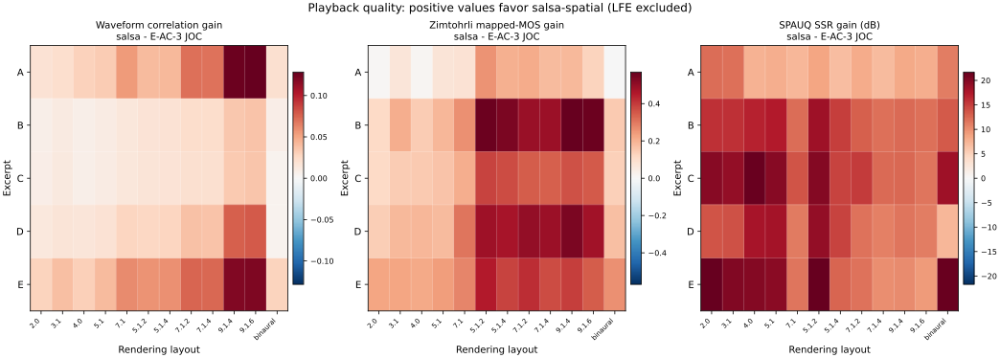

# salsa-spatial playback quality evaluation

Measured on 2026-11-10. The comparison uses a fixed metadata RD weight of
`beta = 7.5e-7` and a 768 kbps total bitrate target. LFE channels are excluded
from every metric; the LFE sweeps in earlier reports are not repeated here.

At 768 kbps, salsa-spatial has higher waveform correlation in all 60
excerpt/layout combinations. Zimtohrli distance is lower in 59 of 60, and
SPAUQ SSR is higher in all 60. SPAUQ SRR is higher in 57 of 60; the three
losses are confined to the opening excerpt's 4.0, 5.1, and 9.1.6 renders.
Across all combinations, correlation rises by 0.004–0.128 (mean 0.036),
relative waveform error falls by 2.42–12.25 dB (mean 7.78 dB), and SPAUQ SSR
rises by 6.74–21.71 dB (mean 13.80 dB).

## Results across rendering layouts

Positive values favor salsa-spatial. LFE channels are excluded from all three
panels. The Zimtohrli panel plots the difference in mean channel mapped MOS;
the only negative cell is the opening excerpt's binaural render, where the MOS
difference is −0.0038. The SPAUQ panel plots the difference in median SSR.

| Excerpt | Actual total (kbps) | Correlation gain across layouts | Layouts with lower Zimtohrli distance | Layouts with higher SPAUQ SSR | Layouts with higher SPAUQ SRR |
|---|---:|---:|---:|---:|---:|
| A | 767.559 | 0.0185–0.1284 | 11 / 12 | 12 / 12 | 9 / 12 |
| B | 764.413 | 0.0073–0.0364 | 12 / 12 | 12 / 12 | 12 / 12 |
| C | 767.809 | 0.0050–0.0355 | 12 / 12 | 12 / 12 | 12 / 12 |
| D | 768.684 | 0.0043–0.0785 | 12 / 12 | 12 / 12 | 12 / 12 |
| E | 768.792 | 0.0284–0.1199 | 12 / 12 | 12 / 12 | 12 / 12 |

The arithmetic means over all 60 excerpt/layout combinations are:

| Metric | salsa-spatial | E-AC-3 JOC |
|---|---:|---:|
| Waveform correlation | 0.9927 | 0.9564 |
| Waveform error (dB, lower is better) | −18.86 | −11.08 |
| Zimtohrli distance (lower is better) | 0.00128 | 0.00286 |
| Zimtohrli mapped MOS (higher is better) | 4.755 | 4.478 |
| SPAUQ SSR (dB, higher is better) | 26.16 | 12.36 |
| SPAUQ SRR (dB, higher is better) | 18.00 | 13.84 |

E-AC-3 JOC uses 768.000 kbps. salsa-spatial's totals include core audio,
metadata, and framing. Full-range core targets were selected once per excerpt
to bring the complete stream to 764.4–768.8 kbps and were held constant during
encoding. The [measurement data](measurements/salsa-spatial-quality.json)
contains the selected targets, rate breakdowns, and channel results.

## Measurement setup

| Item | Setting |
|---|---|
| Source | Five 20-second excerpts starting at 0, 60, 120, 180, and 220 s from one programme with 91 non-LFE objects |
| Reference | Render of the original unclustered DAMF object scene |
| Encoders | salsa-spatial with libopus 1.6.1; Dolby Encoding Engine 6.7.0 |
| E-AC-3 JOC decoding | salsa E-AC-3 JOC decoder to object PCM; the DEE distribution exposes speaker layouts only |
| Speaker rendering | Same renderer for both codecs and the reference; limiter and DRC disabled |
| Programme calibration | Warp mode 3, explicitly set for the reference and both codecs |
| Binaural rendering | Same renderer and Rosella personalized-headphone model for both codecs and the reference |
| Alignment | Fixed stream delays; 958,527 common samples at 48 kHz |

Each excerpt starts with fresh encoder and decoder state. The fixed delay
correction is 1,473 samples for E-AC-3 JOC and zero additional samples for
salsa-spatial. Waveform correlation is the zero-lag normalized correlation
after that delay:

$$
C=\frac{\sum_{c,n}r_{c,n}y_{c,n}}
{\sqrt{\sum_{c,n}r_{c,n}^2\sum_{c,n}y_{c,n}^2}}.
$$

Here, $r$ is the reference render and $y$ is the candidate render. Higher
correlation is better. LFE channels are excluded, and the relative waveform
error in the measurement data uses the same non-LFE channel set:

$$
E=10\log_{10}\frac{\sum_{c,n}(y_{c,n}-r_{c,n})^2}
{\sum_{c,n}r_{c,n}^2}.
$$

Zimtohrli 0.2.1.post1 uses 128 bands at 48 kHz. Both inputs receive the same
−3 dB gain. Channels are evaluated separately and the reported distance and
mapped MOS are arithmetic means. SPAUQ 0.0.1a0 evaluates 10-second blocks with
alignment and scaling disabled; the reported SSR and SRR are medians over
blocks. Both perceptual metrics exclude LFE channels and reference channels
below −100 dBFS RMS.

## Interpretation

The three metrics agree almost everywhere. The only Zimtohrli loss is the
opening excerpt's binaural render, where salsa-spatial distance is 0.001224
and E-AC-3 JOC is 0.001204; mapped MOS is 4.758 and 4.761. Its correlation and
SPAUQ SSR are still higher.

The three SPAUQ SRR losses are the opening excerpt's 4.0, 5.1, and 9.1.6
layouts. In those same layouts salsa-spatial still has higher SSR, higher
correlation, lower Zimtohrli distance, and lower waveform error. SSR includes
spatial placement while SRR measures residual waveform distortion, so the
disagreement is consistent with the opening excerpt's larger spatial
advantage. The other four excerpts have higher SRR in all 48 combinations.
