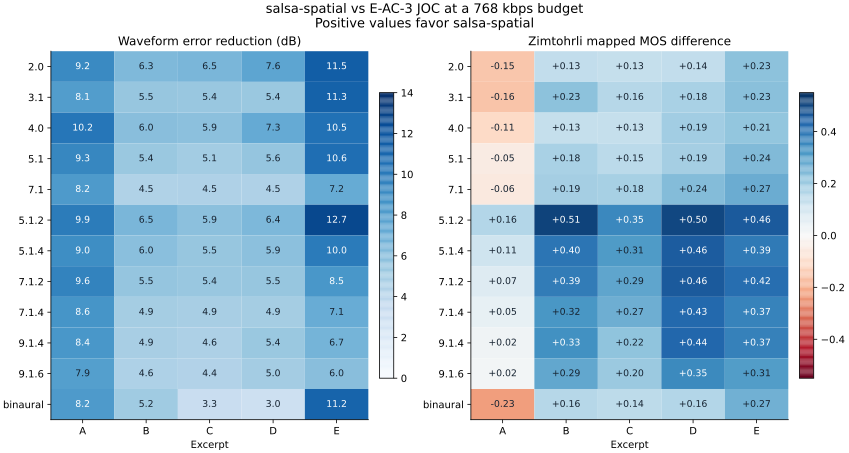
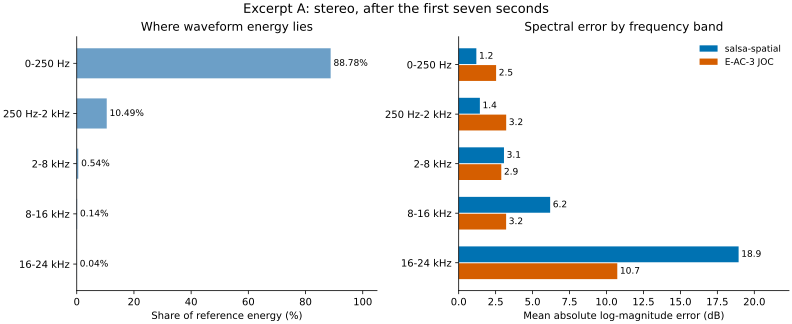
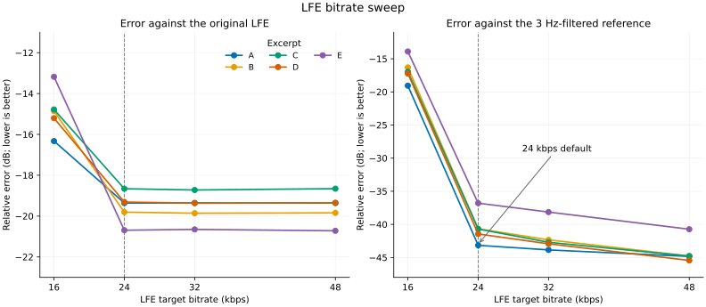

# salsa-spatial quality evaluation

Measured on 2026-11-08. The current configuration uses a 24 kbps VBR LFE
stream and a fixed metadata RD weight of `beta = 1e-6`.

At a 768 kbps total budget, salsa-spatial has lower waveform error in all
60 excerpt/layout combinations. Zimtohrli distance is lower in 54 of 60.
All six Zimtohrli losses occur in the opening excerpt's stereo, conventional
surround, and binaural renders. The other four excerpts have lower waveform
error and Zimtohrli distance in every layout.

## Results across rendering layouts

Positive values favor salsa-spatial. The left panel shows the reduction in
relative waveform error across all output channels, including LFE. The right
panel shows the difference in mean channel Zimtohrli mapped MOS. Independent
LFE channels are excluded from Zimtohrli. Excluding LFE from waveform error
also leaves salsa-spatial ahead in all 60 combinations.

| Excerpt | Actual total (kbps) | Waveform error reduction across layouts | Layouts with lower Zimtohrli distance |
|---|---:|---:|---:|
| A | 766.856 | 7.95–10.20 dB | 6 / 12 |
| B | 765.153 | 4.45–6.47 dB | 12 / 12 |
| C | 764.217 | 3.30–6.49 dB | 12 / 12 |
| D | 766.965 | 2.98–7.55 dB | 12 / 12 |
| E | 765.067 | 5.97–12.72 dB | 12 / 12 |

E-AC-3 JOC uses 768.000 kbps. salsa-spatial's totals include core audio,
metadata, and framing. Full-range core targets were selected once per excerpt
and held constant during encoding. The metadata RD weight was the same for
all excerpts. The [measurement data](measurements/salsa-spatial-quality.json)
contains the targets, rate breakdowns, and channel results.

## Measurement setup

| Item | Setting |
|---|---|
| Source | Five 20-second excerpts from one programme with 91 non-LFE objects |
| Reference | Render of the original unclustered object scene |
| Encoders | salsa-spatial with libopus 1.6.1; Dolby Encoding Engine 5.2.0 |
| E-AC-3 JOC decoding | Official decoder object PCM with metadata from the same bitstream |
| Speaker rendering | Same renderer for both codecs and the reference; limiter and DRC disabled |
| Programme calibration | Warp mode 3, explicitly set for the reference and salsa-spatial |
| Binaural rendering | Same renderer and HRTF model for both codecs and the reference |
| Alignment | Fixed stream delays; 958,527 common samples at 48 kHz |

Each excerpt starts with fresh encoder and decoder state. The fixed delay
correction is 1,473 samples for E-AC-3 JOC and zero additional samples for
salsa-spatial. Waveform error retains the original levels and uses:

$$
E=10\log_{10}\frac{\sum_{c,n}(y_{c,n}-r_{c,n})^2}
{\sum_{c,n}r_{c,n}^2}.
$$

Here, $r$ is the reference render and $y$ is the candidate render. Lower error
is better.

Zimtohrli 0.2.1.post1 uses 128 bands at 48 kHz. Both inputs receive the same
−3 dB gain. ViSQOL uses `visqol-python` 3.8.0 in audio mode, with its default
internal alignment and SPL matching. Both metrics evaluate channels separately
and report their arithmetic mean. Independent LFE channels and reference
channels below −100 dBFS RMS are excluded. The Zimtohrli MOS values are mapped
metric scores; the reported layout score is a mean of channel scores.

## Why the metrics disagree

The opening excerpt has lower waveform error but worse Zimtohrli and ViSQOL
scores in stereo and binaural output. Removing its first seven seconds leaves
the ViSQOL deficit intact:

| Excerpt and render | Evaluated portion | salsa-spatial ViSQOL | E-AC-3 JOC ViSQOL |
|---|---|---:|---:|
| A, stereo | Full interval | 4.056 | 4.378 |
| A, binaural | Full interval | 3.875 | 4.232 |
| A, stereo | After 7 s | 3.645 | 4.177 |
| A, binaural | After 7 s | 3.379 | 3.936 |
| D, stereo | Full interval | 4.138 | 4.258 |

Excerpt D also shows disagreement between the perceptual metrics: stereo
Zimtohrli mapped MOS is 4.892 for salsa-spatial and 4.757 for E-AC-3 JOC,
while ViSQOL ranks E-AC-3 JOC higher.

The spectral analysis uses a 2,048-sample Hann window and a 512-sample hop.
The right panel includes reference time-frequency cells within 80 dB of the
reference peak. Both panels average the two channels.

Frequencies below 2 kHz account for 99.27% of the reference energy in this interval.
salsa-spatial preserves that region more accurately. Its log-magnitude error
is larger at high frequencies, where the reference energy is much lower.
At 8–16 kHz, the errors are 6.19 dB and 3.21 dB respectively. At 16–24 kHz,
they are 18.94 dB and 10.73 dB.

The difference depends on signal strength. If the analysis keeps only cells
within 40 dB of the reference peak, salsa-spatial has lower log-magnitude
error in every band. Including weaker cells exposes the deficit. Total
waveform error gives these cells little weight; it can improve while weak
spectral detail becomes less accurate.

## LFE at 24 kbps

The current LFE stream uses low-delay mono Opus with unconstrained VBR.
The sweep below changes only LFE coding; the other packets stay fixed.

Raising the target from 16 to 24 kbps reduces raw waveform error by
3.0–7.5 dB. The remaining error stays near −20 dB as bitrate increases.
The fixed 3 Hz input filter in libopus accounts for most of that plateau.

The right panel compares decoded LFE with a reference passed through the
same fixed filter response. At 24 kbps, this residual is −36.8 to −43.2 dB,
an improvement of 22.9–24.4 dB over 16 kbps. Higher targets improve it by
smaller amounts. The 24 kbps target produces 22.3–27.8 kbps of actual LFE
payload across the five excerpts.

DEE also applies LFE low-pass filtering. Its error against the unfiltered
source includes that response. Filtering the reference removes the fixed
Opus input-filter response from the coding-error comparison.

The [codec design](salsa-spatial.md) explains the algorithms. The
[implementation guide](salsa-spatial-implementation.md) describes the profile,
pipeline integration, and current gaps.
